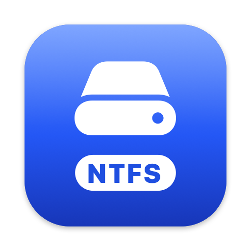

# NTFSTool (open-source edition)

Free, open-source read-write NTFS for macOS, built on Apple's **FSKit** and NTFSTool's own NTFS engine (**libntfstool-driver**).

Plug in a Windows (NTFS) drive and macOS mounts it writable through NTFSTool's FSKit driver module — no kernel
extension, no macFUSE, no reduced security settings, no admin password. The app itself is fully sandboxed.

[简体中文说明](README-CN.md) · [Architecture guide](docs/ARCHITECTURE.md)

