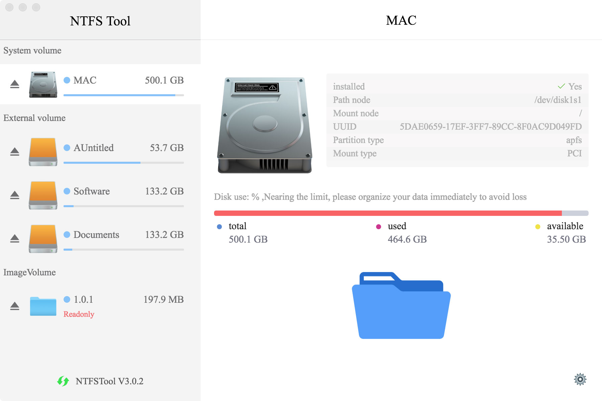
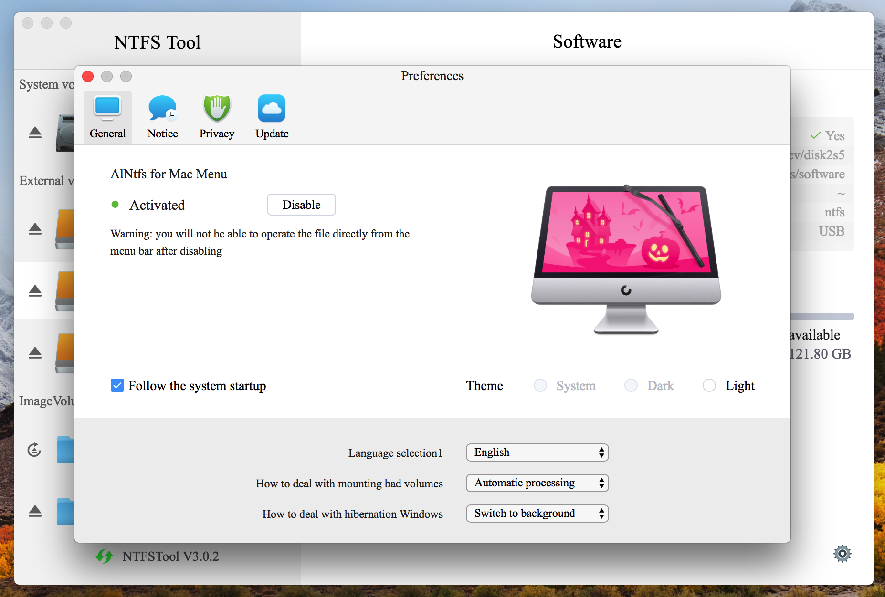

# NTFS Tool
# Support apple chip M1/M2/M3  2024 Start...

<a href="https://ntfstool.com">
  </a>

English | [简体中文](./README-CN.md)

## A free software that provides NTFS read and write support for Apple computers
## NTFS Tool Free For Mac

We are a group of software technology practitioners who love life and love programming. Using scattered time, we have developed this free NTFS Tool for Mac tool.

NTFS Tool is a pure version of NTFS tool that supports NTFS disk read-write, mount, launch, management and other functions. Its interface is simple and easy to use. I hope this tool will bring convenience to your work and life.

If this software is helpful to you, welcome Star's attention.


✈️ [Official Website](https://ntfstool.com) | 📖 [Manual](http://docs.ntfstool.com)

## 🧰 More free Mac tools from NTFS Tool

- 📸 **[wxShot](https://github.com/ntfstool/wxShot)** – the WeChat-style screenshot for macOS that works even when WeChat is not signed in (⌥A, long screenshot, offline text extraction, MIT). ⭐ If it helps you, a Star on [ntfstool/wxShot](https://github.com/ntfstool/wxShot) means a lot.
- 💽 **[NTFS2exFAT](https://github.com/ntfstool/ntfs2exfat)** – safely convert an NTFS drive to exFAT on a Mac, with verified copy.

## 💽 Installation
Download from [GitHub Releases](https://github.com/ntfstool/ntfstool/releases) and install it.

### Platform support

The author's original intention was to provide convenience for operating NTFS disks in MacOS systems, and currently only supports MacOS systems.

### macOS

macOS users can click the link below to jump to the official website and download directly.

[Official Website](https://ntfstool.com)

## ✨ Features

- 🕹 Simple and clear user interface
- 🦄 Support USB mount NTFS disk read and write operations
- ☑️ Supports viewing read-write disk capacity
- 💾 Support manual refresh of disk information
- 🎛 Supports image disk file space occupation tips
- 🚀 Support image disk file uninstall
- 🔔 Notify when operation is complete
- 💻 Supports touch bar shortcuts
- 🤖 Permanent system tray for more convenient operation [TODO]
- 🌑 Dark Mode [TODO]
- 🌍 I18n, [View supported languages](#-internationalization).
- 🎏 ...

## 🖥 User Interface





## ⌨️ Development

### Clone Code

```bash
git clone git@github.com:ntfstool/ntfstool.git
```

### Install Dependencies

```bash
cd ntfstool
npm install
```

If you like [Yarn](https://yarnpkg.com/), you can also use `yarn` to install dependencies.

### Dev Mode

```bash
npm run dev
```

### Build Release

```bash
npm run build
```

After building, the application will be found in the project's `release` directory.

## 🛠 Technology Stack

- [Electron](https://electronjs.org/)
- [Vue](https://vuejs.org/) + [VueX](https://vuex.vuejs.org/) + [Element](https://element.eleme.io)

## ☑️ TODO

...

## 🤝 Contribute [](http://makeapullrequest.com)

If you are interested in participating in joint development, PR and Forks are welcome!

## 🌍 Internationalization

Translations into versions for other languages are welcome 🧐! 

| Key   | Name                | Status |
| ----- | :------------------ | :----- |
| ca    | Català              | 🚧      |
| de    | Deutsch             | 🚧      |
| en-US | English             | ✔️      |
| fa    | فارسی               | 🚧      |
| fr    | Français            | 🚧      |
| ja    | 日本語              | ✔️      |
| ko    | 한국어              | ✔️      |
| pt-BR | Portuguese (Brazil) | 🚧      |
| ru    | Русский             | ✔️      |
| tr    | Türkçe              | 🚧      |
| uk    | Українська          | 🚧      |
| zh-CN | 简体中文            | ✔️      |
| zh-TW | 繁體中文            | ✔️      |

## 📜 License

[MIT](https://opensource.org/licenses/MIT) Copyright (c) 2020-present Dr_rOot
