# NTFSTool (ওপেন-সোর্স সংস্করণ)

macOS-এর জন্য বিনামূল্যের, ওপেন-সোর্স, পড়া-লেখার উপযোগী NTFS, যা Apple-এর **FSKit** এবং NTFSTool-এর নিজস্ব NTFS ইঞ্জিন (**libntfstool-driver**)-এর উপর নির্মিত।

একটি Windows (NTFS) ড্রাইভ লাগান, আর macOS সেটিকে NTFSTool-এর FSKit ড্রাইভার মডিউলের মাধ্যমে লেখার উপযোগী করে মাউন্ট করে — কোনো কার্নেল
এক্সটেনশন ছাড়া, macFUSE ছাড়া, নিরাপত্তা সেটিংস কমানো ছাড়া, অ্যাডমিন পাসওয়ার্ড ছাড়া। অ্যাপটি নিজে সম্পূর্ণভাবে স্যান্ডবক্সে চলে।

[English](../../README.md) · [简体中文](../../README-CN.md) · [繁體中文](README.zh-Hant.md) · [日本語](README.ja.md) · [한국어](README.ko.md) · [Deutsch](README.de.md) · [Français](README.fr.md) · [Español](README.es.md) · [Italiano](README.it.md) · [Português](README.pt.md) · [Русский](README.ru.md) · [العربية](README.ar.md) · [فارسی](README.fa.md) · [Türkçe](README.tr.md) · [हिन्दी](README.hi.md) · **বাংলা** · [Bahasa Indonesia](README.id.md) · [Kiswahili](README.sw.md) · [ไทย](README.th.md) · [Tiếng Việt](README.vi.md)

[আর্কিটেকচার গাইড](../ARCHITECTURE.md)

<p align="center">
  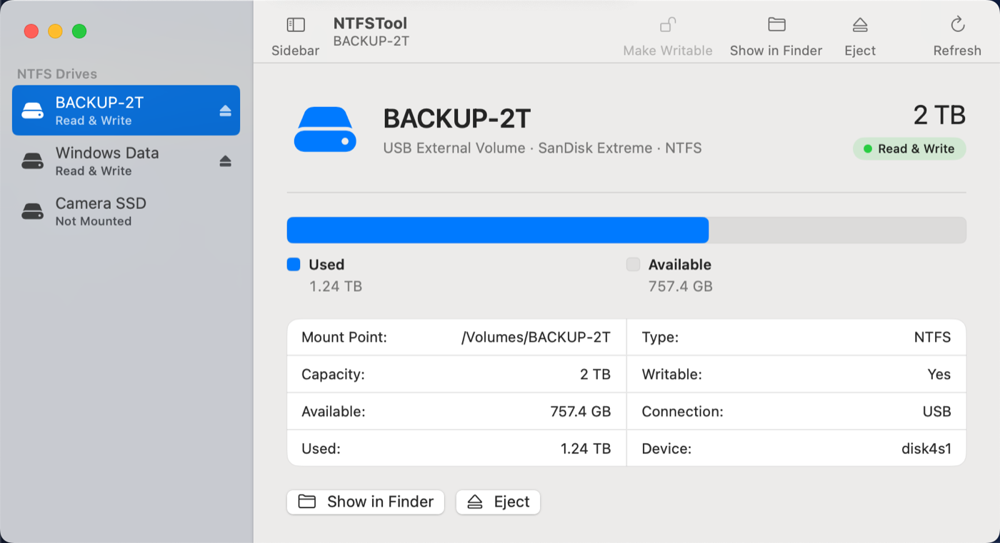
</p>

<p align="center"><i>এই প্রকল্পটি যদি আপনার কাজে লাগে বা ভালো লাগে, GitHub-এ একটি ⭐ অন্যদের এটি খুঁজে পেতে সাহায্য করে।</i></p>

## স্ক্রিনশট

এই রিপোজিটরি থেকে তৈরি করা অ্যাপের আসল স্ক্রিনশট (`make app`)। এখানে দেখানো ড্রাইভগুলো অন্তর্নির্মিত ডেমো মোডের
নমুনা ড্রাইভ (`make demo`), তাই কোনো বাস্তব ডিস্ক ছাড়াই আপনি প্রতিটি স্ক্রিন চেষ্টা করে দেখতে পারেন।

### প্রধান উইন্ডো

আপনার সব NTFS ড্রাইভের জন্য একটি উইন্ডো। প্রতিটি ভলিউমের অবস্থা এক নজরে দেখা যায় — **পড়া ও লেখা**, **শুধু পড়া** অথবা
**মাউন্ট করা নেই** — সঙ্গে থাকে ধারণক্ষমতার বার, মাউন্ট পয়েন্ট, বাস (USB / Thunderbolt) ও ডিভাইসের বিবরণ, এবং *Finder-এ
দেখান* ও *বের করুন*।


| একটি Thunderbolt SSD, পড়া ও লেখা | একটি ড্রাইভ যা মাউন্ট করা নেই |
| --- | --- |
| 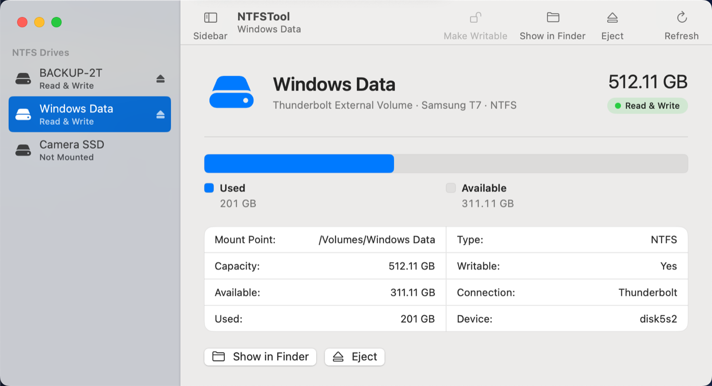 | 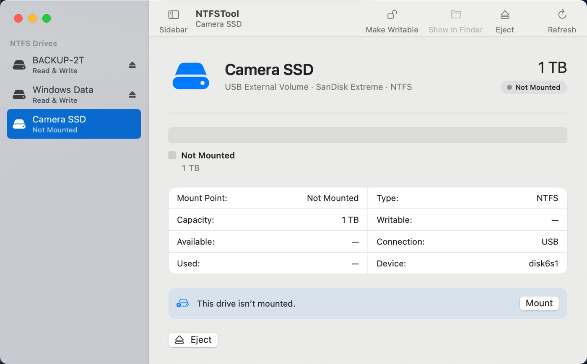 |

### নির্দেশিত সেটআপ: পাসওয়ার্ড ছাড়া, কার্নেল এক্সটেনশন ছাড়া

NTFSTool একটি সাধারণ FSKit ফাইল সিস্টেম মডিউল। macOS শুধু একটি জিনিস চায় — একটি সুইচ চালু করা:
**সিস্টেম সেটিংস → সাধারণ → লগইন আইটেম ও এক্সটেনশন → ফাইল সিস্টেম এক্সটেনশন**। অ্যাপটি ধাপে
ধাপে তা বুঝিয়ে দেয় এবং পরিবর্তনটি নিজে থেকেই টের পায়।

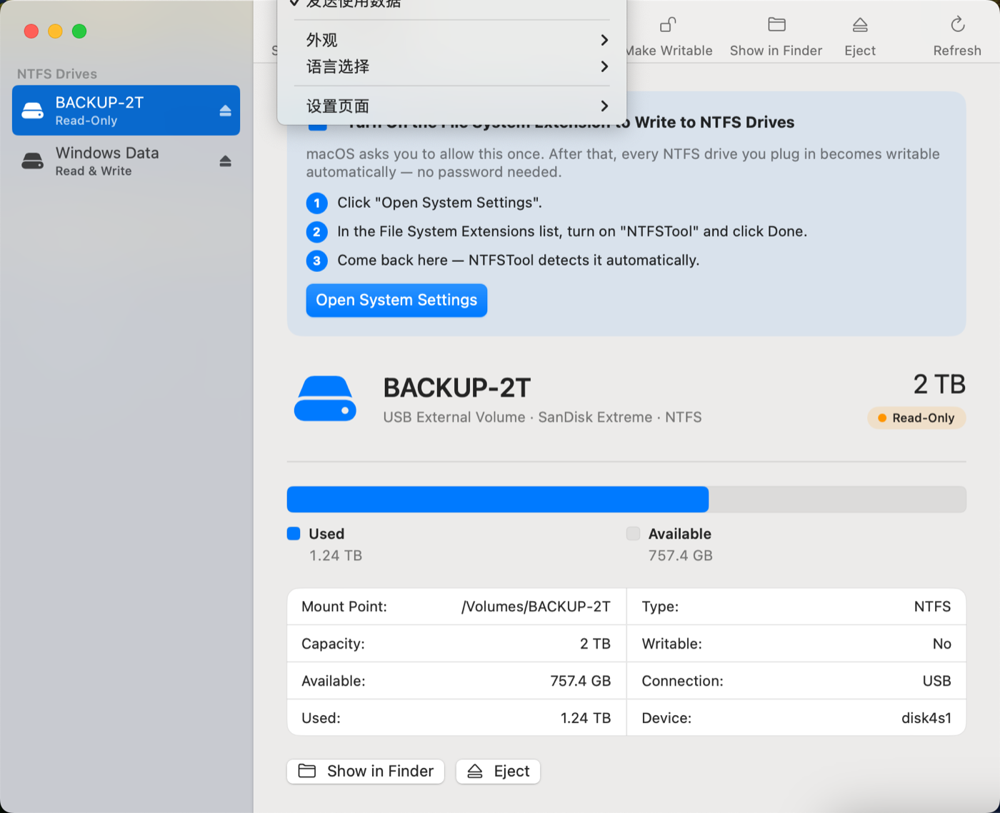

### ডিফল্টভাবে নিরাপদ

Windows হাইবারনেট অবস্থায় থাকলে বা *Fast Startup* চালু থাকলে লেখা ডিস্ককে নষ্ট করে দেবে। NTFSTool এমন ড্রাইভকে
**শুধু পড়ার** মোডে মাউন্ট করে এবং আপনার ডেটাকে ঝুঁকিতে না ফেলে ঠিক কীভাবে সমস্যাটি সারাবেন তা জানিয়ে দেয়।

| Windows যে ড্রাইভকে হাইবারনেট অবস্থায় রেখে গেছে | অ্যাপ আপনাকে যা বলে |
| --- | --- |
| 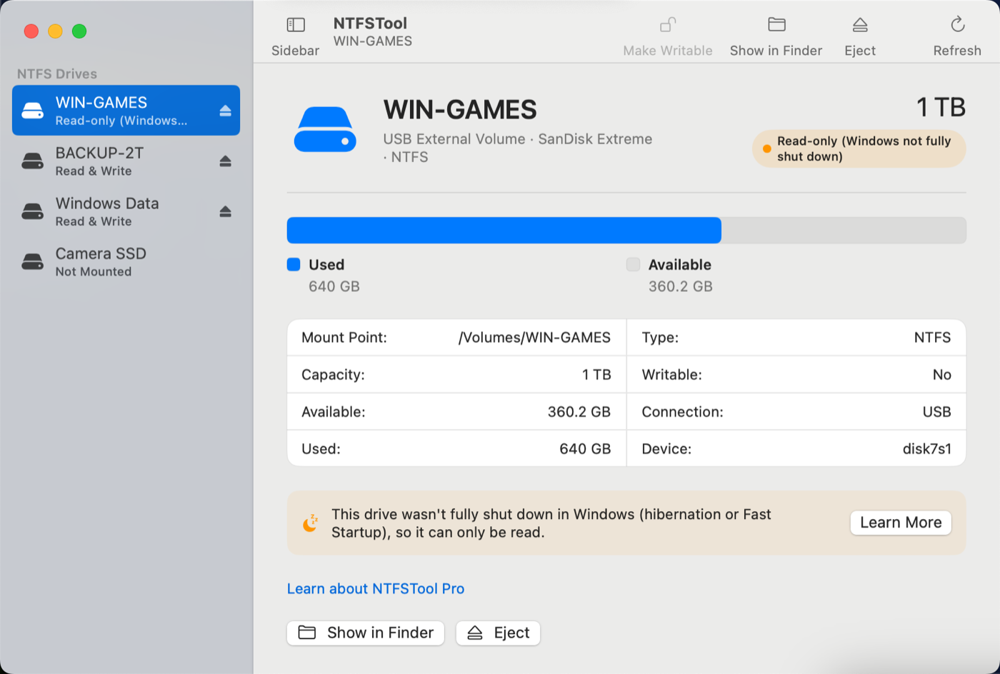 | 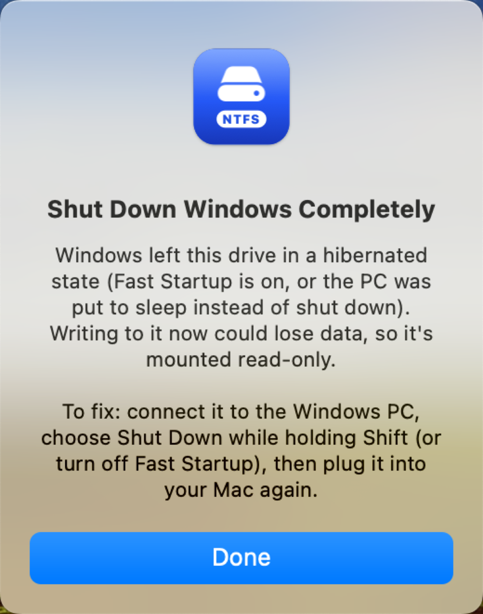 |

### ড্রাইভ আবার লাগানো

macOS শুধু ড্রাইভ লাগানোর সময়ই সিস্টেমকে ফিজিক্যাল ড্রাইভ মাউন্ট করতে দেয়, তাই অ্যাপ ড্রাইভটি নিরাপদে বের করে দেয় এবং
আপনাকে আবার লাগাতে বলে; এরপর সেটি পড়া-লেখার উপযোগী করে মাউন্ট হয়।

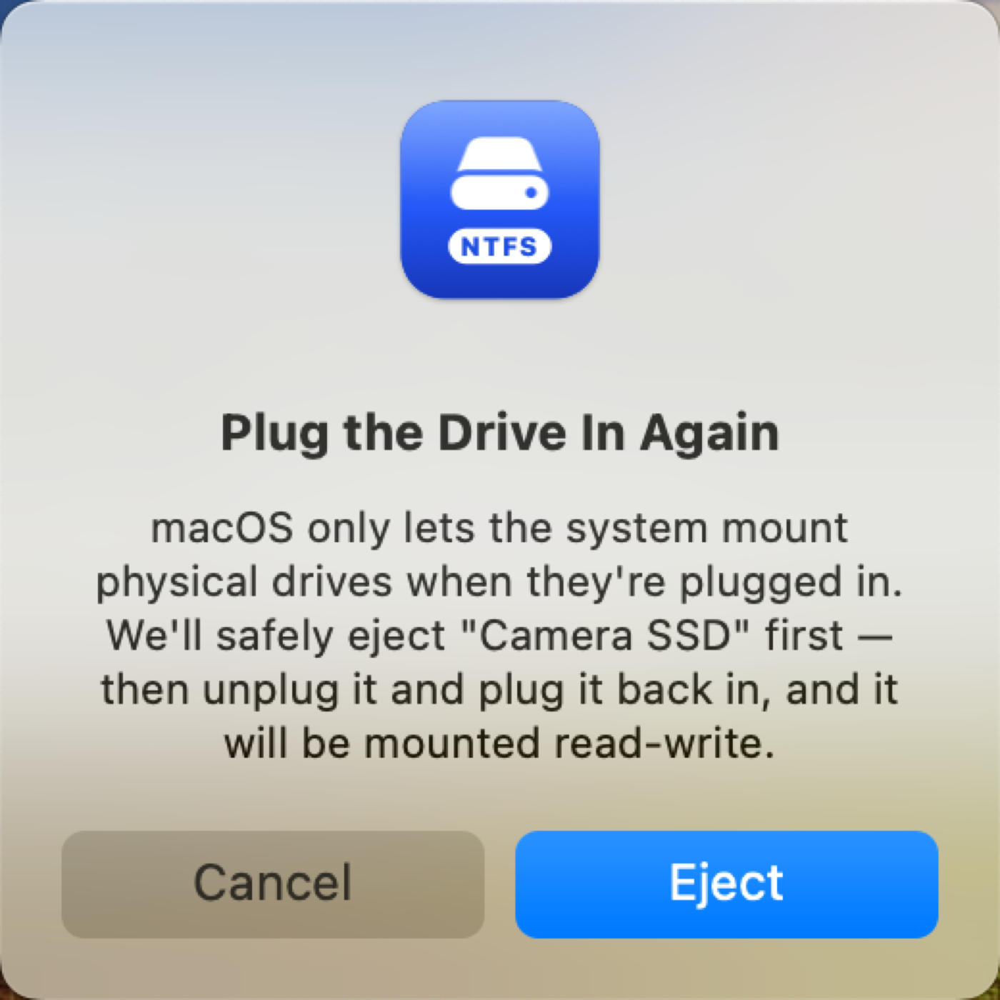

### ডার্ক মোড

| প্রধান উইন্ডো | এক্সটেনশন গাইড |
| --- | --- |
| 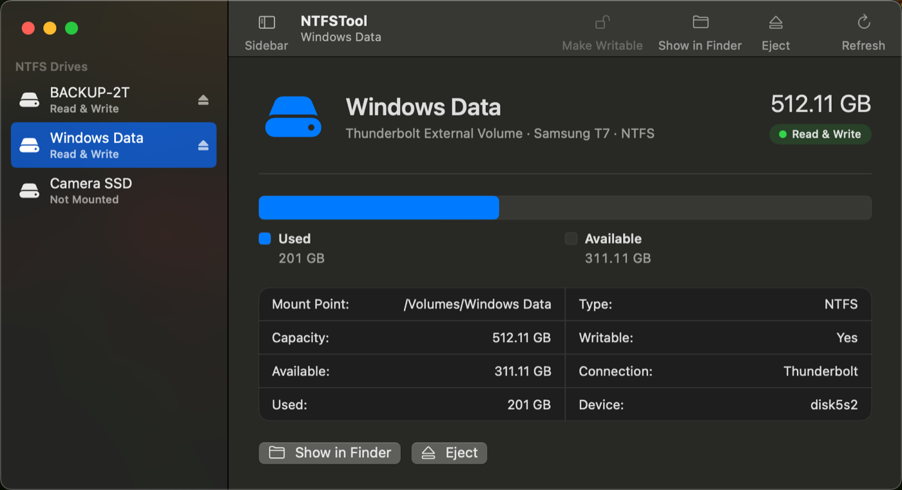 | 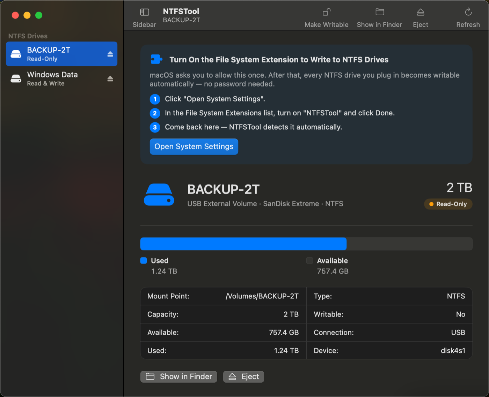 |

### সংক্ষিপ্ত লেআউট, খালি অবস্থা ও পরিচিতি

| সাইডবার লুকানো | ড্রাইভের অপেক্ষায় |
| --- | --- |
| 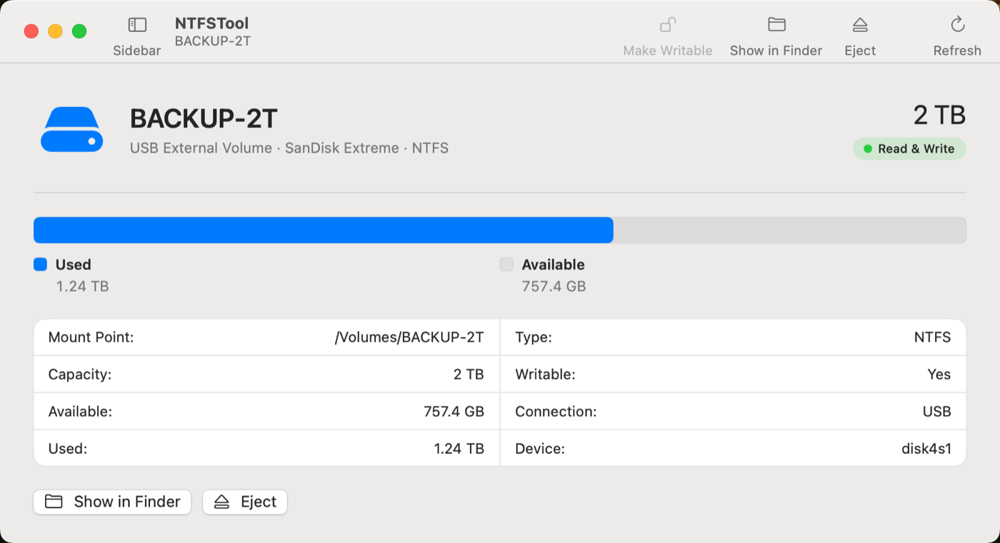 | 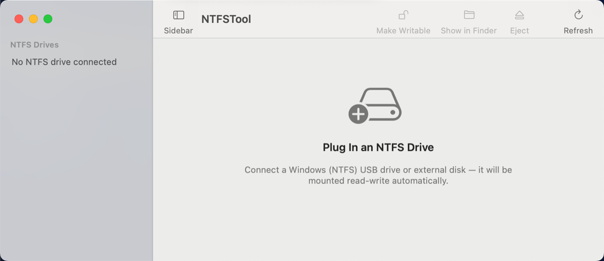 |

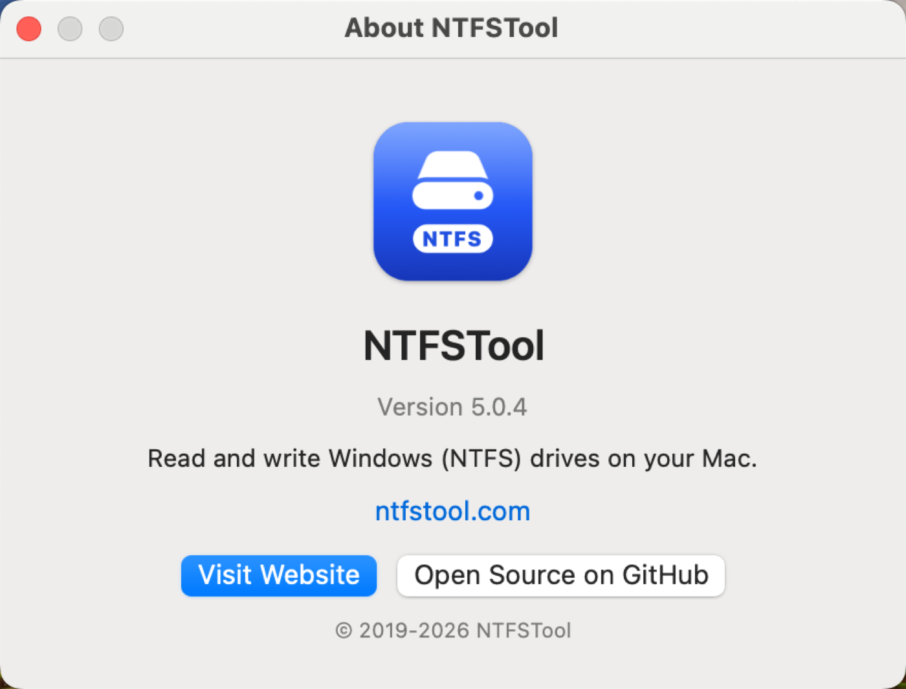

ইন্টারফেস ২০টি ভাষায় পাওয়া যায়, এর মধ্যে আরবি ও ফার্সির জন্য ডান-থেকে-বামের লেআউটও রয়েছে: English,
简体中文, 繁體中文, 日本語, 한국어, Deutsch, Français, Español, Italiano, Português, Русский, العربية, فارسی,
Türkçe, हिन्दी, বাংলা, Bahasa Indonesia, Kiswahili, ไทย এবং Tiếng Việt।

## এই রিপোজিটরি কী

এটি NTFSTool-এর **ওপেন-সোর্স শেখার / রেফারেন্স সংস্করণ**। এটি Mac App Store-এর বিনামূল্যের NTFSTool থেকে তৈরি এবং
একই আর্কিটেকচার ধরে রেখেছে, তবে ইচ্ছাকৃতভাবে ছোট ও পাঠযোগ্য রাখা হয়েছে:

- প্রতিটি সোর্স ফাইলে ইংরেজিতে মন্তব্য আছে, যাতে আপনি একটি FSKit ফাইল সিস্টেম মডিউল, NTFS ইঞ্জিনের উপরের একটি C ব্রিজ এবং
  একটি স্যান্ডবক্সড SwiftUI/AppKit ফ্রন্ট এন্ড কীভাবে একসঙ্গে কাজ করে তা অধ্যয়ন করতে পারেন;
- ড্রাইভারটি সহজ, সরাসরি I/O পথ ব্যবহার করে (কোনো ক্যাশিং স্তর বা প্ল্যাটফর্ম-নির্দিষ্ট পারফরম্যান্স টিউনিং নেই);
- অ্যাপটি শুধু মৌলিক কাজ করে (কোনো টেলিমেট্রি নেই, ডায়াগনস্টিক আপলোড নেই, নেটওয়ার্ক অ্যাক্সেসই নেই);
- কোনো লাইসেন্সিং, অ্যাক্টিভেশন বা ট্রায়াল কোড নেই।

ব্যবহারকারী হিসেবে আপনি যদি সেরা অভিজ্ঞতা চান, [ntfstool.com](https://ntfstool.com) থেকে অফিসিয়াল বিল্ড ইনস্টল করুন।
NTFSTool Pro (ক্লোজড সোর্স) পুরোনো macOS সংস্করণের জন্য দ্বিতীয় একটি ড্রাইভার, ডিস্ক মেরামত এবং অন্যান্য টুল যোগ করে।

## বৈশিষ্ট্য

- NTFS ভলিউম পড়া **ও লেখা**; macOS FSKit ড্রাইভার মডিউলের মাধ্যমে সেগুলো স্বয়ংক্রিয়ভাবে মাউন্ট করে
- স্যান্ডবক্সড অ্যাপ; ড্রাইভারটি ইউজার স্পেসে একটি স্যান্ডবক্সড FSKit মডিউল হিসেবে চলে
- প্রতিটি NTFS ভলিউমের অবস্থা দেখায়: পড়া-লেখা, শুধু পড়া (Windows হাইবারনেট / Fast Startup), Apple-এর অন্তর্নির্মিত
  ড্রাইভারের কারণে শুধু পড়া, মাউন্ট করা নেই
- সিস্টেম সেটিংসে ফাইল সিস্টেম এক্সটেনশন চালু করতে আপনাকে গাইড করে
- Finder-এ খুলুন, বের করুন, ডিস্কের তথ্য
- ২০টি ইন্টারফেস ভাষা
- এক্সটেন্ডেড অ্যাট্রিবিউট NTFS নামযুক্ত স্ট্রিম হিসেবে সংরক্ষিত হয় (কোনো `._` ফাইল নেই); ঐচ্ছিক `windows_names` মাউন্ট অপশন
  Windows যে ফাইলের নাম ব্যবহার করতে পারে না সেগুলো প্রত্যাখ্যান করে

## প্রয়োজনীয়তা

- চালানোর জন্য macOS 15.6 বা তার পরের সংস্করণ; **লেখার সমর্থনের জন্য macOS 26 বা তার পরের সংস্করণ লাগে** (macOS 15-এ সিস্টেম ফিজিক্যাল ডিস্কের জন্য
  Apple-এর শুধু-পড়ার NTFS ড্রাইভারই ব্যবহার করতে থাকে)
- বিল্ড করতে: Xcode 16.3 বা তার পরের সংস্করণ (FSKit SDK) এবং এর কমান্ড লাইন টুল, Swift 5.9+

## বিল্ড — একটি কমান্ডে

```sh
git clone https://github.com/ntfstool/ntfstool.git
cd ntfstool
make            # → build/NTFSTool.app (ad-hoc signed, native architecture)
```

অন্যান্য টার্গেট:

| কমান্ড | কী করে |
| --- | --- |
| `make run` | বিল্ড করে অ্যাপ খোলে |
| `make demo` | মেমোরির ভেতরের ডেমো ডিস্ক দিয়ে UI চালায় — ড্রাইভার লাগে না, Apple Developer অ্যাকাউন্টও লাগে না |
| `make test` | ইউনিট টেস্ট চালায় |
| `make app UNIVERSAL=1` | arm64 + x86_64 বিল্ড করে |
| `make scan` | ট্রির মধ্যে কোনো সাইনিং সামগ্রী বা ব্যক্তিগত শনাক্তকারী আছে কি না যাচাই করে |

ড্রাইভারের টেস্ট `ntfstool-driver` বাইনারির `mkntfs` ও `ntfsfix` সাবকমান্ড দিয়ে আসল NTFS ডিস্ক ইমেজ ফরম্যাট ও পরীক্ষা করে। দুটি টুলই Homebrew-এর `bin`/`sbin`-এ
অথবা `NTFSTOOL_NTFS_TOOLS=<dir>` দিয়ে দেওয়া ডিরেক্টরিতে না পাওয়া গেলে টেস্টগুলো বাদ দেওয়া হয়।

## ড্রাইভার চালানো (আপনার নিজের Apple Developer অ্যাকাউন্ট লাগবে)

FSKit মডিউল সীমাবদ্ধ এনটাইটেলমেন্ট `com.apple.developer.fskit.fsmodule` ব্যবহার করে। macOS শুধু সেই মডিউলই লোড করে
যার স্বাক্ষর এটি প্রদানকারী একটি প্রভিশনিং প্রোফাইল দ্বারা সমর্থিত। অ্যাড-হক বিল্ডে সম্পূর্ণ UI দেখা যায়, কিন্তু
সিস্টেম ড্রাইভার লোড করবে না। এটি Apple-এর প্ল্যাটফর্মের নিয়ম, যা প্রতিটি FSKit প্রকল্পে প্রযোজ্য।

1. আপনার Apple Developer অ্যাকাউন্টে দুটি App ID তৈরি করুন, যেমন `com.yourname.ntfs` এবং `com.yourname.ntfs.fskit`।
   দ্বিতীয়টিতে **FSKit Module** ক্যাপাবিলিটি চালু করুন, এবং ঐচ্ছিকভাবে দুটিতেই একটি App Group
   (যেমন `TEAMID.com.yourname.ntfs`) যোগ করুন, যাতে অ্যাপ ড্রাইভারের লগ পড়তে পারে।
2. দুটির জন্যই ডেভেলপমেন্ট (বা Developer ID) প্রভিশনিং প্রোফাইল তৈরি করে ডাউনলোড করুন।
3. আপনার আইডেন্টিটি দিয়ে বিল্ড করুন:

   ```sh
   TEAM_ID=ABCDE12345 \
   BUNDLE_ID=com.yourname.ntfs \
   SIGN_IDENTITY="Apple Development: Your Name (XXXXXXXXXX)" \
   APP_PROFILE=~/Downloads/app.provisionprofile \
   FSKIT_PROFILE=~/Downloads/fskit.provisionprofile \
   make app
   ```

4. `build/NTFSTool.app` `/Applications`-এ কপি করুন, একবার খুলুন, তারপর ড্রাইভারটি চালু করুন:
   **সিস্টেম সেটিংস → সাধারণ → লগইন আইটেম ও এক্সটেনশন → ফাইল সিস্টেম এক্সটেনশন**।
5. NTFS ড্রাইভটি আবার লাগান। এখন `mount` সেটিকে `ntfstooloss` টাইপসহ দেখাবে।

সব বিল্ড অপশন [`scripts/build-app.sh`](../../scripts/build-app.sh)-এর শুরুতে নথিভুক্ত আছে।
প্রভিশনিং প্রোফাইল ও সাইনিং কী কখনোই এই রিপোজিটরিতে রাখা চলবে না; `make scan` তা যাচাই করে।

## কাঠামো

| পাথ | এটি কী |
| --- | --- |
| `Sources/NTFSTool` | অ্যাপের এন্ট্রি পয়েন্ট (`main.swift`) |
| `Sources/NTFSToolApp` | AppKit শেল, SwiftUI ভিউ, অ্যাপ মডেল, সিস্টেম সার্ভিস, ২০টি লোকালাইজেশন |
| `Sources/NTFSToolCore` | AppKit ছাড়া নির্ভেজাল লজিক: ডিস্ক মডেল, ভাষার তালিকা, সেটিংস স্টোর, স্থানীয় ইভেন্ট লগ |
| `Sources/NTFSToolBridge` | C ব্রিজ (`ntfstool_bridge.c`), যা `libntfstool-driver`-এর উপর inode-ভিত্তিক অপারেশন প্রদান করে |
| `Sources/NTFSToolDriver` | ড্রাইভারের Swift কোর (FSKit নির্ভরতা নেই, যেকোনো macOS-এ ইউনিট-টেস্টযোগ্য) |
| `FSKitModule/NTFSToolFS` | FSKit মডিউল (`NTFSToolFS.appex`), যা macOS NTFS ভলিউম মাউন্ট করতে লোড করে |
| `Tests/` | অ্যাপ মডেল ও ড্রাইভারের ইউনিট টেস্ট (আসল NTFS ইমেজ) |
| `scripts/` | `build-app.sh`, `build-fskit.sh`, `scan-secrets.sh` |

Finder থেকে ডিস্ক পর্যন্ত একটি লেখা কীভাবে পৌঁছায় তা জানতে [docs/ARCHITECTURE.md](../ARCHITECTURE.md) দেখুন।

## অবদান রাখা

ইস্যু ও পুল রিকোয়েস্ট স্বাগত। অনুগ্রহ করে আপনার কমিটগুলোতে সাইন-অফ করুন (`git commit -s`), যাতে
[Developer Certificate of Origin](https://developercertificate.org/) প্রত্যয়িত হয় — [CONTRIBUTING.md](../../CONTRIBUTING.md) দেখুন।

## লাইসেন্স

MIT লাইসেন্স — [LICENSE](../../LICENSE) ও [NOTICE](../../NOTICE) দেখুন।
সংযুক্ত NTFS ইঞ্জিনটি NTFSTool-এর নিজস্ব `libntfstool-driver`, যা পূর্বে-কম্পাইল করা স্ট্যাটিক লাইব্রেরি হিসেবে দেওয়া হয় (দেখুন
[Vendor/README.md](../../Vendor/README.md))।

এই রিপোজিটরির আগের সংস্করণগুলো (Electron অ্যাপ) git ইতিহাসে পাওয়া যায়।

## ট্রেডমার্ক

MIT লাইসেন্স আপনাকে কোড দেয়, ব্র্যান্ড নয়। "NTFSTool" এবং NTFSTool-এর আইকন ও লোগো NTFSTool প্রকল্পের
ট্রেডমার্ক এবং MIT লাইসেন্সের আওতায় **লাইসেন্সকৃত নয়**।

- আপনি এই সোর্স নিজের জন্য বিল্ড ও ব্যবহার করতে পারেন, এবং একে "based on NTFSTool" বলে উল্লেখ করতে পারেন।
- আপনি যদি কোনো পরিবর্তিত সংস্করণ বা ফর্ক **বিতরণ** করেন (যেকোনো অ্যাপ স্টোরসহ), তাহলে তার একটি ভিন্ন
  নাম ও আইকন দিতে হবে, NTFSTool লোগো সরিয়ে ফেলতে হবে এবং নিজের bundle identifier ব্যবহার করতে হবে — এটি যেন NTFSTool-এর অফিসিয়াল
  রিলিজের মতো না দেখায়, বা তেমন দাবি না করে।
- এই রিপোজিটরির অপরিবর্তিত বিল্ড NTFSTool নামে শুধু পূর্বানুমতি নিয়েই পুনরায় বিতরণ করা যাবে।

NTFS ও Windows হলো Microsoft Corporation-এর ট্রেডমার্ক; macOS ও FSKit হলো Apple Inc.-এর ট্রেডমার্ক। এই
প্রকল্প Microsoft বা Apple-এর সঙ্গে সম্পর্কিত নয়।
